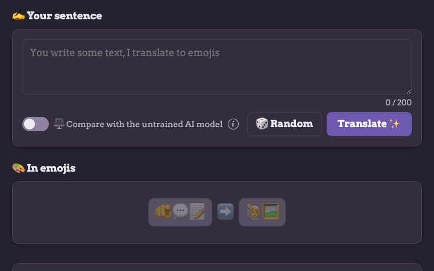

# Emogist

Training a small open-weight model to turn everyday English, French and Spanish sentences into emoji sentences that keep the gist. Live demo: [emogist.esklab.com](https://emogist.esklab.com).

> "I fell asleep on the beach and got a terrible sunburn." → `🏖️😴 ➡️ 🦞🔥 😭`



# The goal of this project

This is an educational project whose goal is to learn how to fine-tune a small LLM to make it better at a specific task. This is done by having a small AI model learn from a bigger model's capabilities, following a teacher/student approach (SFT: Supervised Fine-Tuning).

The idea is to help a very small model, one that can be served on a cheap and simple VPS or on a local machine, gain capabilities while adding little overhead, all at the lowest possible cost and using open-source and free tools as much as possible.

We tested 4 open-weight models to select the best student (Qwen3.5 2B, Qwen3.5 0.8B, Ministral 3B and SmolLM3 3B), and 5 LLMs to select a teacher (DeepSeek V4.1 Flash, DeepSeek V4 Pro, Mistral Large 4, gpt-oss 120B and gpt-oss 20B). We built our own dataset and fine-tuned the selected student to close as much of the gap to its teacher as possible.

Cost of training (all experiments included, dataset and fine-tuning): ≈ $15 ([details](#what-it-cost))
Time invested: 4 days

# Main features and functionalities

- **Full learning loop:** dataset → fine-tuning → evaluation → serving, documented step by step.
- **Emoji grammar:** a small set of rules for time, speech, negation, numbers and cause, in [CONVENTIONS.md](CONVENTIONS.md).
- **Teacher/student training:** an open teacher model labels sentences, and a small open student learns from them with a LoRA adapter.
- **Round-trip evaluation:** one model decodes the emojis without seeing the original, and another judges whether the gist survived.
- **Three languages:** real human sentences plus AI-generated everyday stories, written natively in English, French and Spanish (Spanish from v2, step 8 on).

# Main parts of the project

## How it works

```
                 teacher model (labels)            small student model (fine-tuned)
sentences ──▶  sentence → emoji sentence  ──▶  dataset  ──▶  sentence → emoji sentence  ──▶  API + demo page
```

Every step is evaluated the same way: a **round-trip score**. One model decodes the emoji sentence back into text without seeing the original, and another judges whether the decoded text keeps the gist (see [step 1](01_student_selection/)).

## Steps

| Step | Status | Key result |
|---|---|---|
| [0. Exploration](00_exploration/) | ✅ done | Small models need one sentence per request; validation is mandatory |
| [1. Student selection](01_student_selection/) | ✅ done | Qwen3.5 2B and Ministral 3B tied; Qwen3.5 0.8B behind |
| [2. Teacher selection](02_teacher_selection/) | ✅ done | Five large teachers tied at ~1.3 gist vs ~0.9 for students; thinking adds nothing; DeepSeek V4.1 Flash best on tie-breakers, gpt-oss 120B a credible backup |
| [3. Dataset](03_dataset/) (3,000 EN+FR sentences) | ✅ done | 50/50 mix of real and AI sentences, including exact numbers. [Dataset card](03_dataset/full/README.md) |
| [4. Fine-tuning](04_fine_tuning/) (LoRA, Unsloth) | ✅ done | Qwen 2B chosen on dev, tied with Ministral 3B. On the test set, fine-tuning raised gist from 0.81 to 1.13 (+0.32 [+0.17, +0.47]). Ministral's test run is deferred |
| [5. Evaluation](05_evaluation/) | ✅ done | Judge passed a one-person check (kappa 0.66). Fine-tuned Qwen 1.13 vs teacher 1.31 on test, closing 64% of the gap. Long sentences are its clearest weakness |
| [6. Serving](06_serving/) (GGUF + FastAPI, [live demo](https://emogist.esklab.com)) | ✅ done | The 8-bit model (2 GB) matches the full model on dev (0.75). It loads on demand on a shared VPS |
| [7. v2 rules and scoring](07_v2_rules_and_scoring/) | ✅ done | Short answers (1–2 emojis) allowed as a warning. The three-criteria judge (topic, event, outcome) missed its first human check (0.67 vs 0.7). After two rules were added (mood and exactly who the people are are not penalised), v2.1 passed on 42 fresh pairs: 0.77 [0.60, 0.88], against 0.64 for the v1 judge. Baseline of the v1 model on v2 dev: 0.47 [0.44, 0.51], with Spanish (never trained) level with English and French. v1 results unchanged |
| [8. Spanish and new evaluation sets](08_v2_spanish_and_eval_sets/) | ✅ done | New dev and test sets: 300 sentences each, 100 per language (EN, FR, ES), half real and half AI, all reviewed by the author (79 of 679 removed) |
| [9. v2 dataset and labels](09_v2_dataset_and_labels/) | ✅ done | 6,000 training rows: 2,000 per language (EN, FR, ES), half real and half AI. One label per sentence from DeepSeek V4.1 Flash with the v2 prompt and the author's examples (best-of-n gave no gain). New signs ❓ 💭 🤔 ❔ 📍 🔁; 🔀 and 🔄 tried and dropped. Author's sample review: 7% of labels judged wrong |
| [10. v2 fine-tuning](10_v2_fine_tuning/) | ✅ done | New LoRA on the original Qwen 2B with v1 settings: main (EN+FR+ES) 0.47, the same as v1 on v2 dev; the EN+FR control shows Spanish neither hurt nor helped. A blind Sonnet review leans towards v2 (+0.14, not statistically significant). 4B scores 0.52 (+0.05, proven) but was not kept: twice the size for a small gain. All v2 scores are on dev only: the v2 test set has not been run |
| [11. v2 demo](11_demo_v2/) | ✅ done | The live demo runs v2: one 2B base with switchable v1 and v2 adapters, a compare view with the untrained model, a Spanish page, explained signs, share links, a random-sentence button and an About page in three languages |

## What it cost

Training a small model doesn't need expensive hardware: every training run used a free Google Colab T4 GPU (the v2 model trained in 25 minutes). The money went on API calls.

| Item | Cost |
|---|---|
| Teacher models on Ollama Cloud: candidate tests, generated sentences and labels, v1 and v2 | ≈ $2 |
| Scoring with Claude Haiku (decodes) and Claude Sonnet (judgements), every experiment | ≈ $12 |
| GPU: about 4–5 hours of Colab T4, including the 4B run | $0 |
| **Total, both versions and all experiments** | **≈ $15** |

The final v2 model alone would cost about $2–3: about $1.30 to label 6,000 sentences, one free training run and about $1 to score it. Most of the money went into measuring, not training. The figures are estimates from cached calls and usage pages, and serving (the VPS) is not included.

## Repository layout

```
emoji_eval/          shared code: prompt, validator, model runner, round-trip scorer
data/                v1 fixed test set (evaluation only) + data notes
cache/               cached decodes and judgements, so scores are reproducible for free
00_exploration/      first manual tests
01_student_selection/  compare small models before training
02_teacher_selection/  compare large models that label the data
03_dataset/          v1 sentence sources, labelling prompt, pilot and full dataset
04_fine_tuning/      Colab training notebooks, pilot runs and scores
05_evaluation/       human check of the judge, teacher ceiling, error breakdown
06_serving/          model export, GGUF comparison and serving results
07_v2_rules_and_scoring/  v2 format rules and three-criteria judge
08_v2_spanish_and_eval_sets/  Spanish tooling, new dev and test sets
09_v2_dataset_and_labels/  v2 training sentences and teacher labels
10_v2_fine_tuning/   v2 training notebook and dev scoring
11_demo_v2/          plan and checks for the v2 demo (code in demo/)
demo/                the live demo: API, web page, Docker and deployment files
docs/                images for this README (demo GIF)
CONVENTIONS.md       the emoji grammar used everywhere
```

# Setup

Requires Python 3.10 or later.

```bash
python -m venv .venv && source .venv/bin/activate
pip install -r requirements.txt      # installs emoji_eval in editable mode + dependencies
cp .env.example .env                 # add the API keys you need
```

What each part needs:

| To run | You need |
|---|---|
| Scoring (round trip) | `ANTHROPIC_API_KEY` in `.env`. Saved results reuse `cache/`, so rerunning a step's scoring makes no API calls |
| Student candidates (step 1) | [Ollama](https://ollama.com) with the local models |
| Teachers, sentence generation and labels (steps 2, 3, 8, 9) | Ollama signed in to Ollama Cloud (`ollama signin`) |
| Fine-tuning (steps 4 and 10) | Google Colab with a free T4 GPU: open the step's notebook |
| Model export and serving (steps 6 and 11) | [llama.cpp](https://github.com/ggml-org/llama.cpp) and the packages in `06_serving/requirements-export.txt` |
| The demo, locally | See [demo/README.md](demo/README.md#run-locally) |

The fine-tuned models are not published, so the demo and the export scripts need the adapters to be trained first. Each step's README ends with a "Reproduce" section with its exact commands.

# AI disclosure

- **v1 test sentences** (`data/test_sentences.csv`) were drafted with Claude and reviewed by the author; they are used for evaluation only.
- **v2 dev and test sentences** (step 8) are real Tatoeba sentences and sentences generated by DeepSeek V4.1 Flash and gpt-oss 120B, all reviewed by the author. They are used for evaluation only.
- **Blind-review sentences** (step 10): 100 short sentences written by Claude Sonnet 5.5, for evaluation only.
- **Claude** (Haiku 5.5, Sonnet 5.5) is used as an **evaluator** (decoder and judge), never to write, select or filter training sentences or labels. Claude also helped write this project's code and documentation.
- **Training labels** are generated by DeepSeek V4.1 Flash (MIT), and the AI half of the training sentences by the same model. Both are marked as AI-generated in the dataset cards ([v1](03_dataset/full/README.md), [v2](09_v2_dataset_and_labels/DATASET.md)) and in each row's `source`, `generator` and `teacher` fields.
- **Real sentences** come from [Tatoeba](https://tatoeba.org) (CC BY 2.0 FR), with author attribution kept in the data files.
- **Few-shot labelling examples** were reviewed and written by the author.
- **Demo page text and random-button sentences** were written with Claude. They are not used for training.

# Licence

- **Code:** [MIT](LICENSE).
- **Tatoeba sentences and their labels:** CC BY 2.0 FR, with author credit.
- **AI-generated sentences and their labels:** CC0 1.0.
- **Evaluation material:** published for reproducibility, not licensed for training AI models.

Details and attribution are in [DATA_LICENSE.md](DATA_LICENSE.md).
